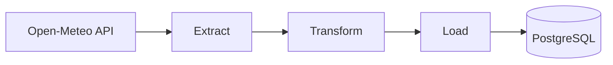

 <div align="center">


# 🌦️ weather-etl

**A mini ETL project that fetches weather data from the Open-Meteo API and loads it into a PostgreSQL database.**


</div>

---

## About the Project

This project implements the basic workflow of a data pipeline:

1. **Extract:** Fetches data from the free [Open-Meteo API](https://open-meteo.com/) (no API key required) using `requests`, with automatic retries on failure. If fetching data for one city fails, the pipeline continues processing the others.
2. **Transform:** Rounds values, filters out readings outside a plausible temperature range (-50 to 60 °C), and records the data collection timestamp.
3. **Load:** Stores the data in a **PostgreSQL** table named `clima`, avoiding duplicate observations.

I built this project to get hands-on experience with API integration, error handling (retries), and relational database persistence — a first step toward data engineering.

---

## Pipeline Workflow



## Project Structure

```text
weather-etl/
├── extract.py        # Fetches weather data from the API, with retries
├── transform.py      # Cleans the data and returns a list of dictionaries
├── load.py           # Connects to PostgreSQL and stores the data
├── main.py           # Ties everything together and runs the pipeline
├── sql/schema.sql    # Creates the clima table
├── .env.example      # Environment variable template
└── requirements.txt  # Project dependencies
```

## How to Run

1. Clone the repository and navigate to the project directory.
2. Create and activate a virtual environment:

   ```bash
   python3 -m venv venv
   source venv/bin/activate
   ```

   For the Fish shell, use:

   ```fish
   source venv/bin/activate.fish
   ```

3. Install the dependencies:

   ```bash
   pip install -r requirements.txt
   ```

4. Copy `.env.example` to `.env` and fill in your PostgreSQL connection details.
5. Create the `weather_etl` database and run the SQL schema:

   ```bash
   psql -d weather_etl -f sql/schema.sql
   ```

6. Run the pipeline:

   ```bash
   python main.py
   ```

## What's Next?

The first version of this project was completed on October 19, 2026. As I gain more experience, I'll keep building on it and adding new layers. Here's the roadmap:

### 1. Refactoring with Pandas and NumPy

- **DataFrame-based processing:** Refactor `transform.py` to convert the API response into a Pandas DataFrame.
- **Vectorized data cleaning:** Use Pandas and NumPy to clean the data, handle null values, and filter temperature ranges (e.g., -50 to 60 °C) through vectorized operations.
- **Data enrichment:** Add derived columns, such as temperature variations and weather alert flags, before loading the data.

### 2. Containerization with Docker

- **Dockerfile:** Create an isolated container environment to run the Python script and its dependencies.
- **Docker Compose:** Run the pipeline alongside a **PostgreSQL** container using a single `docker-compose.yml` file, with networking and persistent volumes configured.

### 3. Orchestration and Scheduling with Apache Airflow

- **DAG creation:** Convert the sequential workflow in `main.py` into an Airflow DAG, split into separate tasks (`extract_task`, `transform_task`, and `load_task`).
- **Scheduled execution:** Configure automatic scheduling (e.g., `@hourly`) to continuously collect weather data.
- **Monitoring:** Track failures, retries, and logs directly from the Airflow dashboard.

