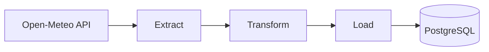

<div align="center">


# 🌦️ weather-etl

**Mini projeto de ETL: coleta dados de clima da API Open-Meteo e carrega em um banco PostgreSQL.**


</div>

---

## Sobre o projeto

Este projeto implementa o fluxo básico de um pipeline de dados:

1. **Extract**: consome a API gratuita [Open-Meteo](https://open-meteo.com/) (não precisa de chave) com `requests`, com retry em caso de falha. Se uma cidade falhar, as outras seguem normalmente.
2. **Transform**: arredonda os valores, descarta leituras fora de um intervalo plausível (-50 a 60 °C) e registra o horário da coleta.
3. **Load**: grava na tabela `clima` do **PostgreSQL**, sem duplicar uma observação já registrada.

Foi criado para praticar o consumo de APIs, o tratamento de erros (retry) e a persistência em banco relacional, como um primeiro passo rumo à engenharia de dados.

---

## Fluxo



## Estrutura

```
weather-etl/
├── extract.py        # busca o clima na API, com retry
├── transform.py      # limpa os dados e devolve uma lista de dicionários
├── load.py           # conecta ao PostgreSQL e grava os dados
├── main.py           # junta as etapas e executa o pipeline
├── sql/schema.sql    # criação da tabela clima
├── .env.example      # modelo das variáveis de ambiente
└── requirements.txt  # dependências
```

## Como rodar

1. Clone o repositório e entre na pasta.
2. Crie e ative o ambiente virtual:
   `python3 -m venv venv` e `source venv/bin/activate`(no fish: `source venv/bin/activate.fish`)
3. Instale as dependências: `pip install -r requirements.txt`
4. Copie `.env.example` para `.env` e preencha com os dados do seu PostgreSQL.
5. Crie o banco `weather_etl` e rode o arquivo `sql/schema.sql` com `psql -d weather_etl -f sql/schema.sql`.
6. Execute: `python main.py`

## Próximos passos

A primeira versão do projeto foi concluída em 19/10/2026. Conforme eu ganhar experiência, vou adicionando novas camadas a ele. Segue o roadmap:

### 1. Refatoração com Pandas e NumPy

- **Manipulação com DataFrames:** refatorar a etapa `transform.py` para converter os dados retornados pela API em um DataFrame do Pandas.
- **Tratamento vetorizado:** usar Pandas e NumPy para limpar os dados, tratar valores nulos e filtrar faixas de temperatura (ex.: -50 a 60 °C) de forma vetorizada.
- **Enriquecimento:** criar colunas derivadas, como variações térmicas e indicadores (flags) de alerta meteorológico, antes da carga.

### 2. Containerização com Docker

- **Dockerfile:** criar um ambiente isolado em container para executar o script Python e suas dependências.
- **Docker Compose:** orquestrar o pipeline junto com um container do **PostgreSQL** em um único `docker-compose.yml`, com redes e volumes persistentes.

### 3. Orquestração e agendamento com Apache Airflow

- **Criação de DAGs:** converter o fluxo sequencial do `main.py` em uma DAG do Airflow, dividida em tasks (`extract_task`, `transform_task`, `load_task`).
- **Execução programada:** configurar o agendamento automático (ex.: `@hourly`) para a coleta contínua dos dados de clima.
- **Monitoramento:** acompanhar falhas, novas tentativas e logs diretamente no painel do Airflow.
